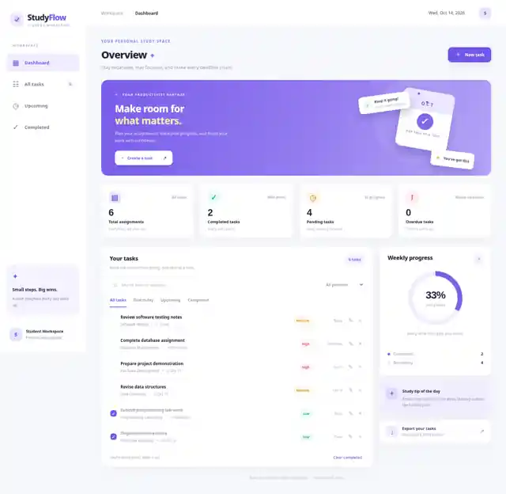
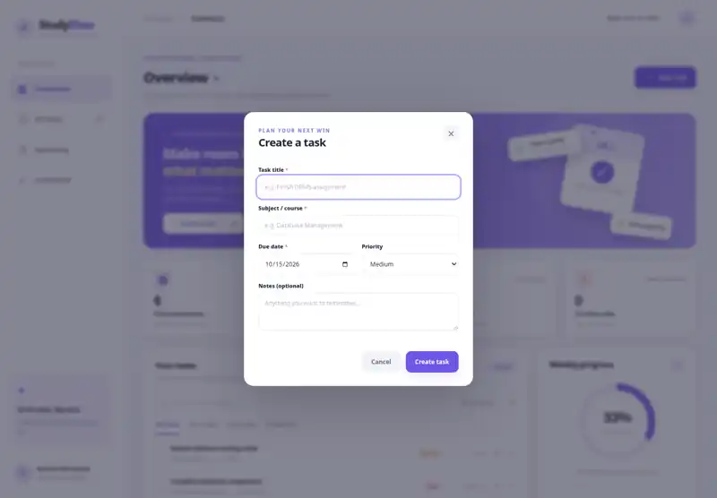

# StudyFlow - Smart Student Task & Assignment Manager

StudyFlow is a clean, responsive student productivity web application built with **HTML, CSS, and vanilla JavaScript**. It keeps assignments and deadlines organized, and stores tasks privately in the browser using **localStorage**.

## Purpose
Students often manage multiple courses and submission deadlines simultaneously. StudyFlow provides a simple, unified dashboard to track tasks, set priorities, mark work complete, and monitor progress without registering for an account.

## Features
- Add tasks with title, subject, due date, priority and optional notes
- Edit and delete tasks; confirm before deleting
- Mark assignments completed or pending
- Dashboard totals for all, completed, pending and overdue tasks
- Completion percentage displayed as a progress ring
- Filter tasks by status (all, due today, upcoming, completed)
- Search by title, subject or notes and filter by priority
- Responsive layout for desktop, tablet, and mobile
- Automatic localStorage persistence between refreshes
- Download your task list as a JSON backup
- Six editable sample tasks on first launch

## Tech stack
| Technology | Purpose |
| --- | --- |
| HTML5 | Semantic application structure, accessible form and task views |
| CSS3 | Layout, components, colors, animations, responsive design |
| JavaScript (ES2020+) | Task CRUD operations, filters, events, statistics |
| localStorage | On-device JSON task persistence without a server |
| GitHub | Source-code hosting and project documentation |

## How to run
1. Download/clone this repository.
2. Open `index.html` in Chrome, Edge, or Firefox, or use the simple local HTTP server below for a stable browser-storage origin. There is no account or API key needed.
3. Click **New task** or **Create a task** to add an assignment.
4. Use checkboxes, edit (pencil) and delete (cross) buttons to manage tasks.
5. Refresh: saved tasks remain in the same browser as long as site storage is not cleared.

Optional local development server:
```bash
python -m http.server 8000
```
Then visit `http://localhost:8000`.

> The interface optionally loads Google Fonts for typography; it falls back to system fonts when offline. No JavaScript libraries or external APIs are needed for task management.

## Usage notes
- StudyFlow uses your browser's local date to determine overdue and upcoming tasks.
- Six sample tasks appear only on first visit. They can be edited or removed.
- Browser storage is device/browser-specific; export a JSON backup if you want a copy. It does **not** sync across devices.
- Deleting/clearing browsing data may remove locally stored tasks.
- Export is a backup only; an import feature is not implemented.

## Folder structure
```
studyflow-task-manager/
├── index.html             # Main user interface and task form
├── styles.css             # Dashboard styling and responsive layout
├── app.js                 # CRUD, filters, statistics, storage and events
├── README.md              # Project overview and execution guide
├── screenshots/           # Genuine working UI captures
└── tests/                 # Automated end-to-end browser test
```

## Screenshots





Screenshots were captured from the working application in a managed Chromium environment; they are compressed for GitHub preview. Full-resolution PNG versions are included in the AAT-1 submission package.

## Development methodology
1. Identified the problem: manual task lists make deadlines hard to track.
2. Designed a responsive dashboard, tasks table, and input dialog.
3. Implemented data structure and localStorage persistence.
4. Added CRUD, priority/search/status filters, due-date checks, and progress calculations.
5. Tested browser interactions and captured screenshots of working results.

## Testing
Automated UI tests use Python `playwright` and a local HTTP server. Some managed browser environments block navigation to local URLs; in that case the test automatically injects the actual app into a blank page and uses an in-memory localStorage substitute. Such a fallback tests UI and read/write logic, **not real disk persistence after browser refresh**.
```bash
pip install playwright
python -m playwright install chromium
python tests/test_app.py
```
Manual checks: open the site, add a task, edit it, mark it done, search, filter, delete it, and refresh to verify real browser persistence.

## Limitations and future enhancements
- Data is stored in one browser, not a shared cloud database.
- No login, push notifications or multi-user support.
- Future versions could include calendar sync, reminder notifications, task import and cloud sync.

## AAT-1 submission
College evaluation requires this repository and README, true browser output screenshots, and a hard-copy report with code snippets and explanation. Repository: https://github.com/nityasree-28/studyflow-task-manager . Include a genuine screenshot of this repository in Section 8 of the printed report. Do not claim cloud sync or AI features that are not implemented.

## Author
Student: **Gurram Nitya sree**  
Course / Subject: **Full stack technologies**  
Academic Year: **2026-27**